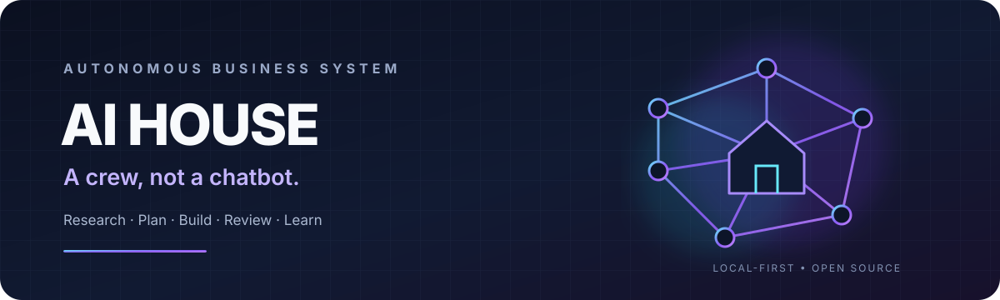
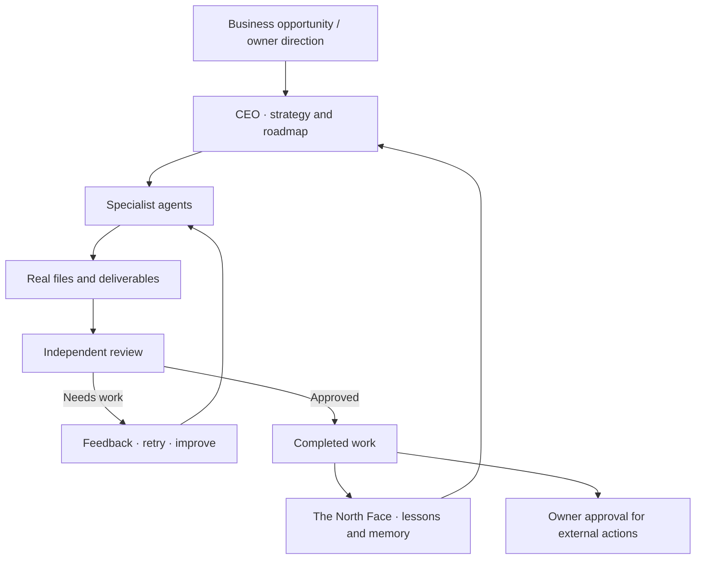

<div align="center">



<p>
  <strong>An autonomous, multi-agent business workspace that researches opportunities, plans work, creates real deliverables, reviews its output, and learns from every cycle.</strong>
</p>

<p>
  <a href="https://github.com/yazoniplay/ai-house/actions/workflows/python-syntax.yml"></a>
  
  
  
  <a href="https://github.com/yazoniplay/ai-house/blob/main/LICENSE"></a>
</p>

<p>
  <a href="#-what-is-ai-house">What it is</a> ·
  <a href="#-how-it-works">How it works</a> ·
  <a href="#-get-started">Get started</a> ·
  <a href="#-rooms-and-capabilities">Capabilities</a> ·
  <a href="#-providers">Providers</a> ·
  <a href="#-safety-and-control">Safety</a>
</p>

</div>

---

## 🏠 What is AI House?

AI House is a local-first autonomous business lab. Instead of giving you one chatbot and a pile of prompts, it coordinates a crew of specialist AI agents around real work.

A leadership agent chooses a direction and builds a roadmap. Specialist agents research, design, engineer, create, analyze, and test. A separate reviewer challenges the result. Failed work can be improved and reviewed again. The North Face records lessons so future cycles can make better decisions.

**The goal:** move from *"here is an idea"* to *"here is the actual work, the files, the review, and what we learned."*

> AI House is still actively being built. It can create and review local deliverables, but a completed task is not automatically a validated business, paying customer, or successful public launch.

## ⚡ How it works



### The operating loop

| Stage | What happens |
|---|---|
| **01 · Decide** | The Leader evaluates the opportunity, constraints, and success metric. |
| **02 · Plan** | Work is split into specialist tasks with dependencies and acceptance criteria. |
| **03 · Execute** | Agents create actual reports, code, designs, campaign assets, and other files. |
| **04 · Challenge** | A reviewer checks the artifact against the requirements and evidence. |
| **05 · Improve** | Rejected work receives concrete feedback and can be retried. |
| **06 · Learn** | The North Face stores root causes, lessons, and operational rules for future work. |

## 🚀 Get started

### Windows — quick start

1. Download the [latest main branch ZIP](https://github.com/yazoniplay/ai-house/archive/refs/heads/main.zip).
2. Extract it to a folder.
3. Open the folder and run **`start-house.bat`**.
4. Add your provider keys to `worker/.env` when prompted by setup.
5. Open [http://127.0.0.1:8000](http://127.0.0.1:8000).

The launcher installs the Python dependencies and starts the local dashboard. Startup errors remain visible in the console.

**Updating without losing your work:** keep a copy of your existing `worker/.env` and the entire `workspace/` folder. Copy both into the newly extracted version before launching it. Keep the old folder until the new version starts successfully. The private `worker/.env` is ignored by Git and is not included in the ZIP.

### Manual start

Requirements: Python 3.12 recommended.

```powershell
python -m pip install -r worker/requirements.txt
python -m pip install flask
python dashboard/server.py
```

Then open [http://127.0.0.1:8000](http://127.0.0.1:8000).

The first dashboard launch starts autonomy automatically. Closing the browser tab does not stop the worker while the dashboard server is running.

### Keep it running

The local dashboard can be registered to start when you sign in to Windows:

```powershell
powershell -ExecutionPolicy Bypass -File dashboard\install_startup.ps1
```

The dashboard server supervises the worker and can restart it after an unexpected exit. **Stop autonomy** disables automatic restarts; **Resume autonomy** turns them back on.

> **Local-runtime note:** AI House runs on the PC hosting it. It cannot continue working while that machine is shut down or asleep. Keep the PC awake for continuous operation.

## 🧠 Rooms and capabilities

AI House is organized around specialist departments and production rooms.

| Room / system | What it is for |
|---|---|
| **Leadership** | Opportunity selection, strategy, roadmaps, dependencies, task review, and owner approvals. |
| **Research** | Market evidence, customer problems, competitor analysis, and source-backed reports. |
| **Studio** | Marketing campaigns, content production, YouTube planning, and creative deliverables. |
| **Coding Room** | Focused software projects, with one flagship app prioritized over scattered prototypes. |
| **Computer Room** | Guarded local desktop actions on the machine running AI House. |
| **Finance & Operations** | Unit economics, budgets, provider capacity, handoffs, and operational planning. |
| **The North Face** | Persistent task lessons, root causes, decisions, and business postmortems. |
| **Discord integration** | Notifications and supported owner interactions from Discord. |

### Real deliverables, not just chat

Agents are expected to return physical files. The local runner writes approved output paths into the workspace, and the dashboard's Outbox lets you preview and download finished work.

Typical outputs include:

- Research dossiers, source tables, and business reports
- Product briefs, architecture plans, and implementation files
- Test plans, regression tests, and QA reports
- Marketing campaigns, copy, and outreach drafts
- Video scripts, rendered assets, thumbnails, and asset credits

The local engine currently executes roadmap tasks sequentially. The agent roster represents specialist roles assigned to the work; it does not mean every role is running concurrently.

## 🔌 Model and search providers

AI House uses a provider-agnostic routing layer. Configure whichever services you have access to; unavailable providers are skipped or cooled down according to the failure type.

Supported model providers include:

- **Gemini**
- **Groq**
- **NVIDIA NIM**
- **Cloudflare Workers AI**
- **OpenRouter**
- **Hugging Face**
- **Token Harbor**
- **SambaNova**
- **Vercel AI Gateway**
- **Z.ai**
- **SiliconFlow**
- **OrcaRouter**
- **BazaarLink**
- **AgentRouter**
- **Routeway**
- **Ollama**

Search integrations include **Tavily**, **Exa**, and a DuckDuckGo fallback.

Provider availability, model catalogs, account limits, billing, and model IDs can change. A configured key does not guarantee that a provider has free credits or that every model is currently available. AI House uses cooldowns and fallbacks, but provider outages can still delay work.

### Configure secrets

Copy `worker/.env.example` to `worker/.env`, then add the keys you want to use. Keep the private file on your machine.

Common variables:

| Variable | Used for |
|---|---|
| `GEMINI_API_KEY` | Gemini models |
| `GROQ_API_KEY` | Groq models |
| `NVIDIA_API_KEY` | NVIDIA NIM |
| `CLOUDFLARE_API_TOKEN` + `CLOUDFLARE_ACCOUNT_ID` | Cloudflare Workers AI |
| `OPENROUTER_API_KEY` | OpenRouter |
| `AGENTROUTER_API_KEY` | AgentRouter |
| `ROUTEWAY_API_KEY` | Routeway |
| `TAVILY_API_KEY` / `EXA_API_KEY` | Web research |
| `PEXELS_API_KEY` | Stock footage retrieval for video production |

See [`worker/.env.example`](worker/.env.example) for the complete list and optional model overrides.

**Never commit API keys, OAuth tokens, cookies, or your private `.env` file.** Do not paste secrets into issues, Discord, screenshots, or logs.

## 🛡️ Safety and control

AI House is designed to keep the owner in control of consequential actions.

- Public publishing, outreach, purchases, and other configured risky actions require approval.
- YouTube uploads default to **private**; publishing is a separate approved action.
- Sales and customer outreach agents create drafts; they do not silently send messages.
- Computer Room actions use a guarded local bridge. App launching is restricted to configured aliases; arbitrary shell execution is not exposed through that bridge.
- Computer actions are tied to their approval payload. Changing the action invalidates the approval.
- Provider keys stay in local environment files and are not stored in the dashboard/browser.
- Research and business reports must distinguish evidence from assumptions. Planned interviews, unverified demand, and completed product usage must never be presented as facts.

Use a dedicated Windows account or VM for desktop automation, with only the business files and accounts the agents need. Do not expose a personal desktop session containing sensitive information.

## 📁 Project layout

```text
ai-house/
├── dashboard/       Local web dashboard, API, and Windows startup helper
├── worker/          Autonomy engine, specialist prompts, providers, and integrations
├── docs/            Project visuals and documentation
├── supabase/        Optional cloud/control-plane work
├── workspace/       Local business files, state, reports, and generated deliverables
├── start-house.bat  Windows launcher
└── README.md
```

The `workspace/` directory contains local state and generated business work. It is not a substitute for a remote backup. Back it up separately.

## 🎬 YouTube production

For supported video-production tasks, AI House can create a structured video recipe, generate narration with Edge TTS, retrieve scene-matched Pexels footage, edit a 1080p video with FFmpeg, burn captions, and create a thumbnail and asset-credit manifest.

Local setup:

1. Add `PEXELS_API_KEY` to `worker/.env`.
2. Install dependencies from `worker/requirements.txt`.
3. Install FFmpeg and FFprobe and add both to PATH.
4. Configure Tavily and/or Exa for current source-backed research.

The renderer is a production foundation, not a guarantee of accuracy, audience retention, or viral performance. The Leader should review the script, footage, captions, claims, and thumbnail before anything is published.

## 🧪 Development and checks

The repository includes a GitHub Actions workflow that compiles the Python code and runs the worker regression suite on pushes and pull requests to `main`.

Run the checks locally:

```powershell
python -m py_compile worker/*.py dashboard/server.py
python -m unittest discover -s worker -p "test_*.py" -v
```

When changing autonomy behavior, add regression tests for the failure mode—not just the happy path. In particular, test provider fallbacks, malformed model output, approval gates, dependency recovery, file safety, and claims about external actions.

## 🧭 Current boundaries

AI House is an actively evolving project. The local engine is not a hosted 24/7 service, and a completed internal task does not prove product-market fit or revenue. External integrations depend on valid credentials, account permissions, provider availability, and owner approval. Some workflows—especially real customer interviews, public distribution, OAuth refresh, and production deployment—still require explicit setup or human participation.

## 🤝 Contributing

Issues and pull requests are welcome. Useful contributions include focused bug reports with reproducible steps, tests for autonomy failures, provider compatibility fixes, and improvements to specialist workflows.

Before submitting a change:

1. Explain the user/business problem it solves.
2. Keep the change scoped and preserve existing working behavior.
3. Add regression tests for the behavior changed.
4. Never include secrets, private workspace data, or customer information.

---

<div align="center">

**AI HOUSE** · Research deeply. Build deliberately. Review honestly. Learn continuously.

<sub>Built to turn a collection of AI models into a coordinated crew that ships real work.</sub>

</div>
